# 🚀 KubeDeploy (Cloud Deployment Engine)

[](https://k3s.io/)
[](https://www.terraform.io/)
[](https://www.jenkins.io/)
[](https://www.docker.com/)
[](https://aws.amazon.com/)
[](https://react.dev/)
[](https://nodejs.org/)

**KubeDeploy** is an enterprise-grade, self-hosted **Cloud Platform-as-a-Service (PaaS)** (similar to Vercel, Netlify, or Render) built specifically for containerized web applications. It transforms raw cloud infrastructure into an intelligent, automated application hosting platform.

With KubeDeploy, developers connect their GitHub repositories via OAuth, and the platform automatically handles the entire lifecycle: multi-stage Docker compilation, automated AWS infrastructure provisioning via **Terraform Workspaces**, intelligent node scheduling, zero-downtime rolling deployments onto **K3s Kubernetes** clusters, Layer-7 **Traefik Ingress** path routing with prefix stripping behind a shared **AWS Application Load Balancer (ALB)**, and real-time SSH health and resource telemetry.

---

## 📑 Table of Contents

- [Core Capabilities](#-core-capabilities)
- [System Architecture](#-system-architecture)
  - [High-Level Architectural Diagram](#high-level-architectural-diagram)
  - [Deployment Lifecycle & Traffic Routing Flow](#deployment-lifecycle--traffic-routing-flow)
  - [Multi-Tenant URL Generation & Path Isolation Mechanics](#multi-tenant-url-generation--path-isolation-mechanics)
- [Greedy Priority Scheduling Algorithm](#-greedy-priority-scheduling-algorithm)
- [Repository Structure](#-repository-structure)
- [Standard Environment Requirements](#-standard-environment-requirements)
  - [Prerequisites](#prerequisites)
  - [Environment Variables (`.env`) Specification](#environment-variables-env-specification)
  - [AWS Cloud & IAM Configuration](#aws-cloud--iam-configuration)
- [Jenkins Pipelines Overview](#-jenkins-pipelines-overview)
- [Step-by-Step Installation & Local Setup](#-step-by-step-installation--local-setup)
- [Terraform Infrastructure Provisioning](#-terraform-infrastructure-provisioning)
- [Troubleshooting & Gotchas](#-troubleshooting--gotchas)
- [License](#-license)

---

## ⚡ Core Capabilities

- **One-Click Git-to-Cloud Deployments**: Authenticates via GitHub OAuth, clones repositories, detects frontend frameworks (React, Vite, Next.js, CRA), and compiles optimized multi-stage Docker containers.
- **Shared AWS Application Load Balancer (ALB) Routing**: Hosts thousands of independent applications on a single public ALB using Traefik Layer-7 subpath routing (`/apps/{deployment_id}/`), eliminating the cost of provisioning a separate cloud load balancer per project.
- **Dual-Route High Availability**: Generates both an **ALB Public Route** (`http://${ALB_DNS}/apps/${ID}/`) and a **Direct Node Fallback Route** (`http://${NODE_IP}:80/apps/${ID}/`) for instant debugging and firewall resilience.
- **Dynamic Infrastructure as Code (IaC)**: Decouples base networking (VPC, Multi-AZ Subnets, ALB, Security Groups) from ephemeral compute instances (`server-1`, `worker-N`) using isolated **Terraform Workspaces**.
- **Automated Worker Auto-Scaling**: When existing nodes reach capacity ($10$ active deployments) or exhaust resources, the scheduler automatically triggers Jenkins to provision a new AWS EC2 worker node via Terraform, joins it to the K3s cluster via AWS SSM tokens, and resumes deployment.
- **30-Second SSH Node & Pod Telemetry**: A daemon continuously polls cluster nodes via secure SSH tunnels to gather live CPU, RAM, Disk, Uptime, and exact pod counts, automatically flagging unresponsive nodes as `OFFLINE`.
- **Zero-Downtime Rollbacks & Lifecycle Controls**: One-click rollback to prior deployment states, container stop/start controls, and real-time streaming build logs.
- **Dual-Role Management Portals**:
  - **User Dashboard (Sleek Dark Mode)**: Project creation, deployment history, build logs, and resource utilization.
  - **Admin Control Plane (Clean High-Contrast Mode)**: Server fleet management, manual scale-out, cluster metrics, and user access request approvals.

---

## 🏛️ System Architecture

### High-Level Architectural Diagram

The system operates across three primary environments: **Client/Developer Layer**, **Local Orchestration Control Plane**, and the **AWS Cloud K3s Cluster**.

```mermaid
graph TB
    subgraph ClientLayer ["1. CLIENT & DEVELOPER LAYER"]
        Dev["👨‍💻 Developer / User"]
        Admin["🛡️ Platform Admin"]
        GitHub["🐙 GitHub Cloud (OAuth / Git Repo)"]
    end

    subgraph ControlPlane ["2. LOCAL ORCHESTRATION CONTROL PLANE (Minikube / Docker)"]
        direction TB
        Frontend["🌐 React Frontend (Nginx)<br/>Port: 30007"]
        Backend["⚙️ Express.js Backend API<br/>Port: 5000"]
        DB[("🗄️ MongoDB Database<br/>Users / Deployments / Servers")]
        Scheduler["🧠 Priority Node Scheduler<br/>Active Deployments & Resource Matching"]
        Monitor["📡 30s SSH Telemetry Monitor<br/>CPU / RAM / Disk / Pods"]
        Jenkins["🔨 Jenkins CI/CD Controller<br/>Port: 8080 (Docker Container)"]

        Frontend <-->|REST API / WebSockets| Backend
        Backend <--> DB
        Backend --> Scheduler
        Backend --> Monitor
        Backend -->|Trigger Pipelines| Jenkins
    end

    subgraph AWSCloud ["3. AWS CLOUD DEPLOYMENT INFRASTRUCTURE (us-east-2)"]
        subgraph VPC ["VPC (10.0.0.0/16) across 2 Availability Zones"]
            direction TB
            ALB["⚖️ AWS Shared Application Load Balancer<br/>DNS: kubedeploy-alb-xxx.elb.amazonaws.com<br/>Listener: Port 80 (HTTP)"]
            TG["🎯 ALB Target Group: kubedeploy-tg-http<br/>Target: Port 80 | Health: /ping (200-404)"]
            SSM["🔑 AWS SSM Parameter Store<br/>/kubedeploy/k3s-join-token (SecureString)"]

            ALB --> TG

            subgraph ServerNode ["EC2: K3s Control Plane Server (Workspace: server-1)"]
                direction TB
                TraefikMaster["🚦 Traefik Ingress Controller (Port 80)"]
                K3sMaster["👑 K3s Server Engine (API Port 6443)"]
                SystemPods["📦 Core DNS & Metrics Server"]
            end

            subgraph WorkerNode ["EC2: K3s Worker Node (Workspace: worker-N)"]
                direction TB
                TraefikWorker["🚦 Traefik Ingress Router (Port 80)"]
                K3sAgent["⚙️ K3s Agent Service"]
                AppPod1["📦 App Pod: react-app-xxx<br/>Nginx Container (Port 80)"]
                AppPod2["📦 App Pod: node-app-yyy<br/>Web Container (Port 80)"]
            end

            TG -->|Forward Port 80| TraefikMaster
            TG -->|Forward Port 80| TraefikWorker
            K3sAgent -->|Join Cluster over Private IP| K3sMaster
            K3sMaster -->|Read/Write Join Token| SSM
            K3sAgent -->|Read Join Token| SSM
        end
    end

    Dev -->|Access UI| Frontend
    Admin -->|Manage Fleet| Frontend
    Dev -->|Authorize OAuth| GitHub
    Jenkins -->|Git Clone| GitHub
    Jenkins -->|SSH Execute / SCP Images / Kubectl| ServerNode
    Jenkins -->|SSH Execute / SCP Images / Kubectl| WorkerNode
    Monitor -->|SSH Polling (Port 22)| ServerNode
    Monitor -->|SSH Polling (Port 22)| WorkerNode
    Dev -->|Visit App via ALB URL| ALB
    Dev -->|Visit App via Direct URL| WorkerNode
```

---

### Deployment Lifecycle & Traffic Routing Flow

The diagram below connects every dot from git commit to public URL response:

```mermaid
sequenceDiagram
    autonumber
    actor Dev as Developer
    participant UI as React Dashboard
    participant API as Backend (Express/Mongo)
    participant Sched as Node Scheduler
    participant Jenk as Jenkins Pipeline
    participant AWS as AWS EC2 (Terraform)
    participant K3s as K3s & Traefik
    participant ALB as AWS Application Load Balancer

    Dev->>UI: Submit GitHub Repo URL & Framework
    UI->>API: POST /deployments (repoUrl, projectName)
    API->>API: Generate unique DEPLOYMENT_ID (UUIDv4)
    API->>Sched: Select Optimal Node for Deployment
    
    alt All Servers at Capacity or None Exist
        Sched-->>API: No healthy server available
        API->>Jenk: Trigger deploy-server pipeline
        Jenk->>AWS: Terraform apply (create EC2 worker)
        AWS->>AWS: Auto-join K3s cluster via SSM Token
        AWS-->>API: New server registered (healthy)
    end

    Sched-->>API: Target server selected (server.publicIp)
    API->>Jenk: Trigger kubedeploy-stable-v2 (DEPLOYMENT_ID, REPO, TARGET_IP, ALB_DNS)
    
    rect rgb(20, 25, 35)
        Note over Jenk: Docker Build & Path Baking
        Jenk->>Jenk: Git clone application repository
        Jenk->>Jenk: Generate Multi-Stage Dockerfile with BASE_PATH=/apps/{DEPLOYMENT_ID}/
        Jenk->>Jenk: npm run build -- --base=/apps/{DEPLOYMENT_ID}/
        Jenk->>Jenk: Export container image to image.tar
    end

    Jenk->>K3s: SCP image.tar & k3s ctr images import
    
    rect rgb(20, 30, 25)
        Note over Jenk,K3s: Manifest Synthesis & Ingress Wiring
        Jenk->>K3s: Apply Deployment (Pod: react-app-{DEPLOYMENT_ID})
        Jenk->>K3s: Apply Service (ClusterIP: Port 80)
        Jenk->>K3s: Apply Traefik Middleware (StripPrefix: /apps/{DEPLOYMENT_ID})
        Jenk->>K3s: Apply Ingress (Route: /apps/{DEPLOYMENT_ID} -> Service)
    end

    Jenk->>ALB: Probe http://{ALB_DNS}/apps/{DEPLOYMENT_ID}/ until HTTP 200 OK
    Jenk->>API: POST /deployments/{id}/status (status: RUNNING, url: ALB_URL, directUrl: DIRECT_URL)
    API->>UI: Push Status Update via WebSocket / Long Polling
    
    Note over Dev,ALB: Browser Traffic Resolution
    Dev->>ALB: GET /apps/{DEPLOYMENT_ID}/index.html
    ALB->>K3s: Forward Port 80 (Target Group)
    K3s->>K3s: Traefik matches path & strips /apps/{DEPLOYMENT_ID}
    K3s->>K3s: Forward GET /index.html to container
    K3s-->>Dev: HTTP 200 OK (Render React App)
```



---

### Multi-Tenant URL Generation & Path Isolation Mechanics

A frequent problem with single-domain multi-tenant hosting is that client-side routers and bundlers (Vite/React/Next) emit absolute asset paths like `<script src="/assets/index.js">`. If twenty applications live on the same domain, `/assets/index.js` would collide and fail.

KubeDeploy solves this through a **3-part coordinated pipeline**:

```text
1. BROWSER REQUEST
   http://kubedeploy-alb-xxx.elb.amazonaws.com/apps/046135e3-f907-45a3-81ac-225e4a70e7d4/assets/index.js
                                              └───────────────────┬──────────────────┘
                                                          Prefix Envelope
                                                                 │
2. AWS APPLICATION LOAD BALANCER                                 │
   Blind wildcard listener forwards all Port 80 traffic ─────────┤
   directly to cluster nodes.                                    │
                                                                 │
3. TRAEFIK INGRESS CONTROLLER (EC2 Port 80)                      │
   - Reads Ingress Rule matching path: ──────────────────────────┘
     /apps/046135e3-f907-45a3-81ac-225e4a70e7d4
   - Executes StripPrefix Middleware:
     Strips "/apps/046135e3-f907-45a3-81ac-225e4a70e7d4"
   - Rewritten request:
     GET /assets/index.js
                                                                 │
4. CONTAINER NGINX ROOT (/usr/share/nginx/html)                  │
   - Serves file from: ──────────────────────────────────────────┘
     /usr/share/nginx/html/assets/index.js  -->  HTTP 200 OK!
```

---

## 🧠 Greedy Priority Scheduling Algorithm

When an application is queued for deployment, KubeDeploy's backend scheduler ([backend/services/scheduler.js](file:///c:/nvm/COLLEGE/DEVOPS/KubeDeploy/backend/services/scheduler.js)) evaluates all registered nodes with a deterministic 4-tier tie-breaking algorithm:

$$\text{Healthy / Online} \longrightarrow \min(\text{Active Deployments}) \longrightarrow \min(\text{CPU \%}) \longrightarrow \min(\text{RAM \%}) \longrightarrow \min(\text{Disk \%})$$

```
                   Incoming Deployment Request
                                │
                                ▼
               Fetch all Servers where status == 'ACTIVE'
                                │
               Is candidate list empty or all servers at capacity?
                                │
                ┌───────────────┴───────────────┐
               YES                              NO
                │                               │
                ▼                               ▼
    Trigger Auto-Provisioning        Rank candidates by:
    via deploy-server.pipeline       1. Lowest activeDeployments (< 10)
    (Terraform AWS EC2 workspace)    2. Lowest cpuUsage (%)
                │                    3. Lowest ramUsage (%)
                ▼                    4. Lowest diskUsage (%)
    Wait for Node Registration                  │
                │                               ▼
                └──────────────────────> Assign Target Server
```

---

## 📁 Repository Structure

```text
.
├── backend/                            # Node.js Express Backend Service
│   ├── controllers/                    # Admin, Auth, Deployment, Server controllers
│   ├── models/                         # Mongoose schemas (Deployment, Infrastructure, Server, User)
│   ├── routes/                         # Express REST API routes
│   ├── services/                       # Scheduler, SSH monitor, Queue & Jenkins orchestrators
│   ├── terraform/                      # Backend Terraform modules (Base & Server)
│   └── server.js                       # Primary HTTP & WebSocket entrypoint
├── frontend/                           # React 18 (Vite) Single Page Application
│   ├── src/
│   │   ├── admin/                      # High-contrast Admin Control Plane views
│   │   ├── components/                 # Navigation, Modals, Logs, Metrics charts
│   │   ├── pages/                      # Project dashboard, deployment viewer, settings
│   │   └── api.js                      # Axios API client
│   └── nginx.conf                      # Production Nginx reverse-proxy configuration
├── jenkins/                            # Declarative Jenkins CI/CD Pipelines
│   ├── kubedeploy-stable-v2.pipeline   # App container build, packaging & K3s deployment
│   ├── deploy-server.pipeline          # Terraform EC2 node & K3s cluster provisioning
│   └── Destroy-Server.pipeline         # Clean EC2 workspace & node decommissioning
├── k8s/                                # Kubernetes manifests for local platform hosting
│   ├── backend-deployment.yaml         # Express Backend Pod definition
│   ├── backend-service.yaml            # Backend ClusterIP (Port 5000)
│   ├── frontend-deployment.yaml        # React Frontend Pod definition
│   └── frontend-service.yaml           # Frontend NodePort (Port 30007)
├── scripts/                            # Professional Local CI & Redeployment Automation
│   ├── README.md                       # Comprehensive guide to local scripts
│   ├── redeploy.ps1                    # PowerShell Minikube redeployment script
│   ├── redeploy.sh                     # Bash/Linux Minikube redeployment script
│   └── redeploy.cmd                    # Windows CMD wrapper
├── terraform/                          # Production Clean Infrastructure as Code (IaC)
│   ├── README.md                       # Architecture & deployment instructions
│   ├── base/                           # Root Base infrastructure module (ALB, VPC, IAM)
│   ├── server/                         # Root Server infrastructure module (EC2, K3s)
│   └── modules/                        # Reusable modular definitions (base, server)
└── README.md                           # Master Project Documentation
```

---

## ⚙️ Standard Environment Requirements

### Prerequisites

| Tool | Version | Purpose |
| :--- | :--- | :--- |
| **Node.js** | `>= 18.0.0` (LTS 20 or 22 recommended) | Runtime for Express backend & Vite frontend |
| **Docker Desktop / Engine** | `>= 24.0` | Local container runtime & image builds |
| **Minikube** | `>= 1.30.0` | Local Kubernetes orchestration cluster |
| **kubectl** | `>= 1.27.0` | Kubernetes cluster control CLI |
| **Terraform** | `>= 1.5.0` | Cloud Infrastructure as Code engine |
| **AWS CLI** | `>= 2.10.0` | Cloud resource validation & credential manager |
| **Jenkins** | `>= 2.400 LTS` | Declarative pipeline execution engine |

---

### Environment Variables (`.env`) Specification

Create a `.env` file in `backend/.env` (refer to [backend/.env.example](file:///c:/nvm/COLLEGE/DEVOPS/KubeDeploy/backend/.env.example)):

```env
# ==============================================================================
# Server & Database Configuration
# ==============================================================================
PORT=5000
MONGODB_URI=mongodb://localhost:27017/CDE
JWT_SECRET=your_super_secret_jwt_key_here

# ==============================================================================
# Jenkins CI/CD Controller
# ==============================================================================
# When running Jenkins in Docker, host.docker.internal reaches the host machine
JENKINS_URL=http://host.docker.internal:8080
JENKINS_USER=admin
JENKINS_TOKEN=your_jenkins_api_token_or_password
JENKINS_DEPLOY_JOB=kubedeploy-stable-v2
JENKINS_PROVISION_JOB=deploy-server
JENKINS_DESTROY_JOB=Destroy-Server

# ==============================================================================
# Terraform Paths (Inside the Jenkins Container)
# ==============================================================================
TF_BASE_DIR=/var/jenkins_home/terraform/base
TF_SERVER_DIR=/var/jenkins_home/terraform/server

# ==============================================================================
# AWS & SSH Infrastructure Configuration
# ==============================================================================
AWS_DEFAULT_REGION=us-east-2
SSH_USER=ubuntu
SSH_KEY_PATH=/var/jenkins_home/p377-key.pem

# Shared Application Load Balancer DNS (Populated upon Base Provisioning)
ALB_DNS=kubedeploy-alb-881970620.us-east-2.elb.amazonaws.com

# ==============================================================================
# GitHub OAuth App Credentials
# ==============================================================================
GITHUB_CLIENT_ID=your_github_oauth_client_id
GITHUB_CLIENT_SECRET=your_github_oauth_client_secret
GITHUB_CALLBACK_URL=http://localhost:30007/auth/github/callback

# ==============================================================================
# Frontend Public Address
# ==============================================================================
FRONTEND_URL=http://localhost:30007
```

---

### AWS Cloud & IAM Configuration

To allow Terraform and Jenkins to provision and orchestrate infrastructure, ensure your AWS credentials or IAM user possesses policies for:
- **AmazonEC2FullAccess**: For VPC, Subnets, Internet Gateways, Security Groups, and EC2 instances.
- **ElasticLoadBalancingV2FullAccess**: For the Application Load Balancer, Listeners, and Target Groups.
- **AmazonSSMFullAccess**: For reading and writing `/kubedeploy/k3s-join-token` securely across cluster nodes.
- **IAMFullAccess (Scoped)**: To create `kubedeploy-k3s-server-role` and `kubedeploy-k3s-agent-profile`.

---

## 🔧 Jenkins Pipelines Overview

KubeDeploy relies on 3 specialized declarative Jenkins pipelines located in `jenkins/`:

| Pipeline Name | Source File | Responsibilities |
| :--- | :--- | :--- |
| **`kubedeploy-stable-v2`** | [kubedeploy-stable-v2.pipeline](file:///c:/nvm/COLLEGE/DEVOPS/KubeDeploy/jenkins/kubedeploy-stable-v2.pipeline) | Clones target GitHub repo; generates multi-stage Dockerfile with `--base=/apps/${ID}/`; builds container; transfers tarball via SCP; imports to K3s containerd; applies Kubernetes Deployment, Service, Traefik Middleware, and Ingress; probes ALB for HTTP 200; notifies backend. |
| **`deploy-server`** | [deploy-server.pipeline](file:///c:/nvm/COLLEGE/DEVOPS/KubeDeploy/jenkins/deploy-server.pipeline) | Provisions Base Infra (ALB, VPC) if not present; selects/creates target Terraform workspace (`worker-N`); boots Ubuntu 24.04 EC2; bootstraps K3s Server or Agent via SSM; attaches instance to ALB Target Group on Port 80; registers node with backend. |
| **`Destroy-Server`** | [Destroy-Server.pipeline](file:///c:/nvm/COLLEGE/DEVOPS/KubeDeploy/jenkins/Destroy-Server.pipeline) | Selects specified Terraform workspace; runs `terraform destroy -auto-approve`; de-registers instance; deletes the workspace; updates cluster state. |

---

## 🚀 Step-by-Step Installation & Local Setup

### 1. Clone the Codebase
```bash
git clone https://github.com/shane235k/Cloud-Deployment-Engine.git
cd Cloud-Deployment-Engine
```

### 2. Start Minikube
```bash
minikube start --driver=docker --cpus=4 --memory=8192
```

### 3. Start Jenkins Container
Run the official Jenkins container with Docker socket and persistence volume mounted:
```bash
docker run -d \
  --name kubedeploy-jenkins \
  -p 8080:8080 \
  -p 50000:50000 \
  -v jenkins-data:/var/jenkins_home \
  -v /var/run/docker.sock:/var/run/docker.sock \
  kubedeploy-jenkins
```

### 4. Build and Deploy Platform Services (Local CI)
Use the included automation script to build images directly into Minikube and deploy all Kubernetes resources:

**On Windows (PowerShell):**
```powershell
.\scripts\redeploy.ps1
```

**On Linux / macOS / WSL:**
```bash
chmod +x ./scripts/redeploy.sh
./scripts/redeploy.sh
```

### 5. Expose the Frontend Application
Forward port `30007` to access the dashboard:
```bash
kubectl port-forward svc/frontend-service 30007:80
```
Open your browser at **[http://localhost:30007](http://localhost:30007)**.

---

## 🏗️ Terraform Infrastructure Provisioning

To manually provision the AWS cloud infrastructure using the clean templates in `terraform/`:

### 1. Provision Shared Base Infrastructure (VPC, Subnets, ALB)
```bash
cd terraform/base
terraform init
cp terraform.tfvars.example terraform.tfvars
terraform apply -auto-approve
```

### 2. Provision K3s Control Plane Server
```bash
cd ../server
terraform init
terraform workspace new server-1
terraform workspace select server-1
cp terraform.tfvars.example terraform.tfvars
terraform apply -auto-approve -var="is_control_plane=true"
```

### 3. Provision Scalable Worker Agents
```bash
terraform workspace new worker-1
terraform workspace select worker-1
terraform apply -auto-approve \
  -var="is_control_plane=false" \
  -var="k3s_server_private_ip=<SERVER_PRIVATE_IP>"
```

---

## 🛠️ Troubleshooting & Gotchas

> [!TIP]
> **503 Service Temporarily Unavailable on ALB Links**  
> If the ALB returns a 503, verify that:
> 1. The EC2 instance is registered with target group `kubedeploy-tg-http` on port 80.
> 2. K3s `servicelb` is enabled (do **not** pass `--disable servicelb` to K3s), which allows Traefik to bind port 80 on the host interface.
> 3. Security group `k3s_nodes_sg` allows inbound TCP 80 from `alb_sg`.

> [!IMPORTANT]
> **React/Vite Blank Screen with SyntaxError: Unexpected token '<'**  
> This happens if Traefik's `StripPrefix` middleware is missing or if Vite assets were compiled with root `/` instead of `--base=/apps/${DEPLOYMENT_ID}/`. Ensure the pipeline builds the container using `--build-arg BASE_PATH=/apps/${DEPLOYMENT_ID}/`.

> [!NOTE]
> **Low-Memory EC2 Instances (t3.micro)**  
> Running Kubernetes and compiling Docker containers on a `t3.micro` instance can trigger the Linux Out-Of-Memory (OOM) killer. The server cloud-init user data automatically allocates a **2GB swapfile** (`/swapfile`) to maintain stability during intensive builds.

---

## 🛡️ License

Distributed under the **MIT License**. See `LICENSE` for details.
